

  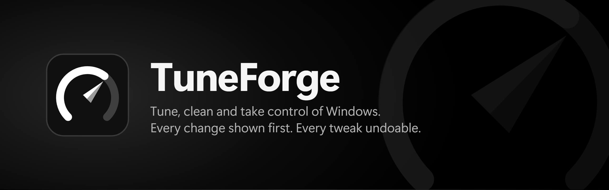

  
  
  
  

<h3 align="center">
  <a href="https://github.com/D3MON999/TuneForge/releases/latest">Download TuneForge</a>
</h3>

  An all-in-one Windows optimizer that shows you every change before it happens and lets you undo your tweaks.

 

  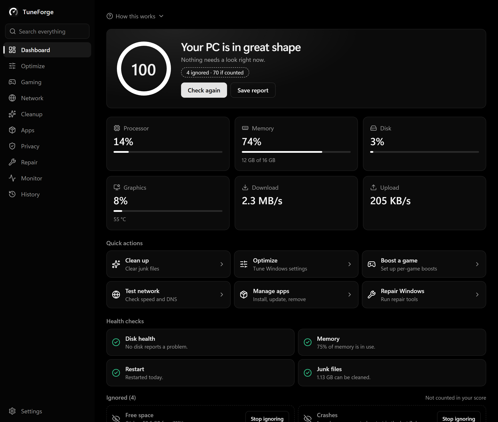

## Why TuneForge

- **You stay in control.** See exactly what each tweak changes before you apply it, then undo it later from History.
- **One app instead of ten.** Tweaks, cleanup, app management, game boosts, network tools and repairs all live in one place.
- **Plain English.** Every setting explains what it does and warns you about any downside.
- **Built with anti-cheat in mind.** TuneForge leaves anti-cheat software alone, and anything risky for Riot Vanguard stays off until you confirm it.
- **Nothing extra.** There are no accounts, ads or telemetry, and nothing keeps running unless you ask it to.

## What it does

<table>
  <tr>
    <td width="50%">
      <h3>Optimize</h3>
      177 tweaks for performance, privacy, Windows, the taskbar, Explorer and more. Pick them one at a time or start from a preset.
    </td>
    <td width="50%">
      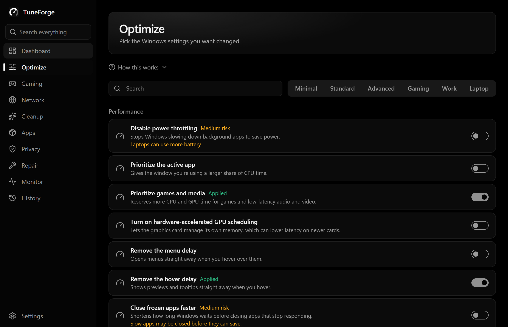
    </td>
  </tr>
  <tr>
    <td width="50%">
      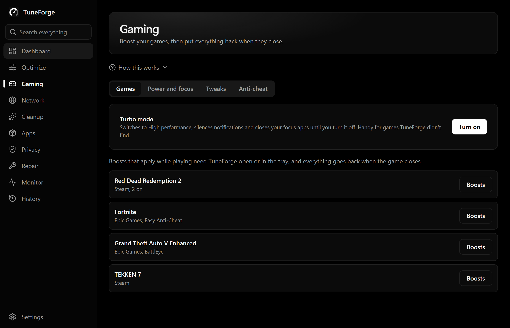
    </td>
    <td width="50%">
      <h3>Gaming</h3>
      Set up boosts for each game, and they're put back when it closes. Turbo mode, power plans and focus tools are here too.
    </td>
  </tr>
  <tr>
    <td width="50%">
      <h3>Cleanup</h3>
      Clear temporary files, caches and crash reports, and see how much space each one takes first.
    </td>
    <td width="50%">
      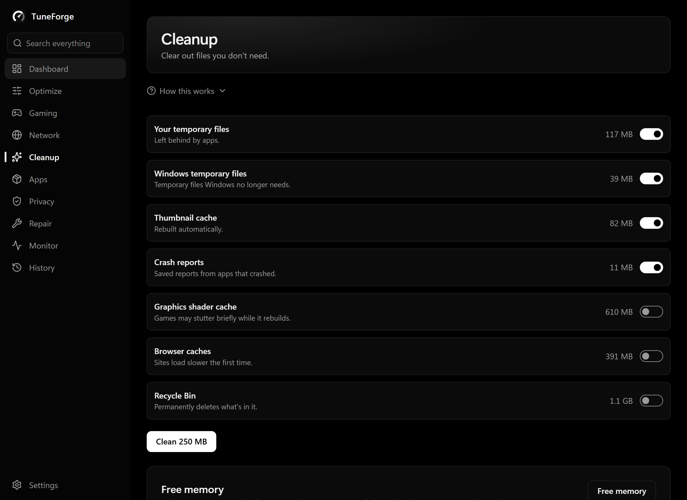
    </td>
  </tr>
  <tr>
    <td width="50%">
      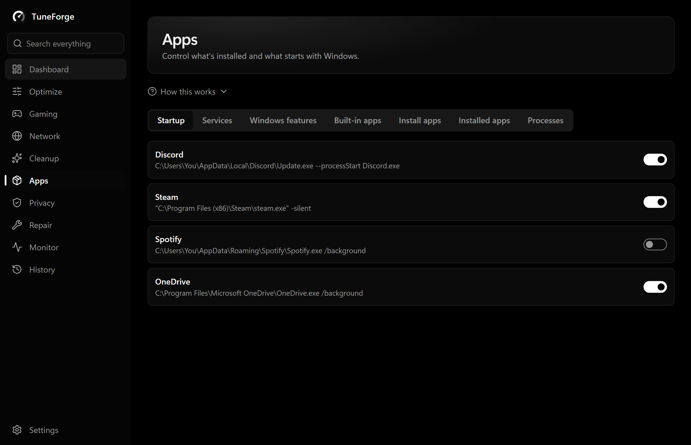
    </td>
    <td width="50%">
      <h3>Apps</h3>
      Install, update and remove programs, remove built-in Windows apps, and manage startup programs and services.
    </td>
  </tr>
  <tr>
    <td width="50%">
      <h3>Monitor and repair</h3>
      Check disks, graphics and Windows errors, then run Windows' own repair tools. The network tools add a speed test, ping, trace and a DNS changer.
    </td>
    <td width="50%">
      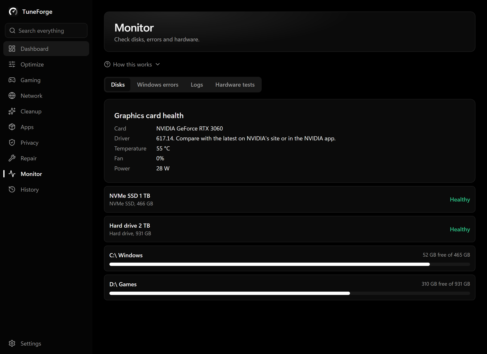
    </td>
  </tr>
</table>

## Safe by design

  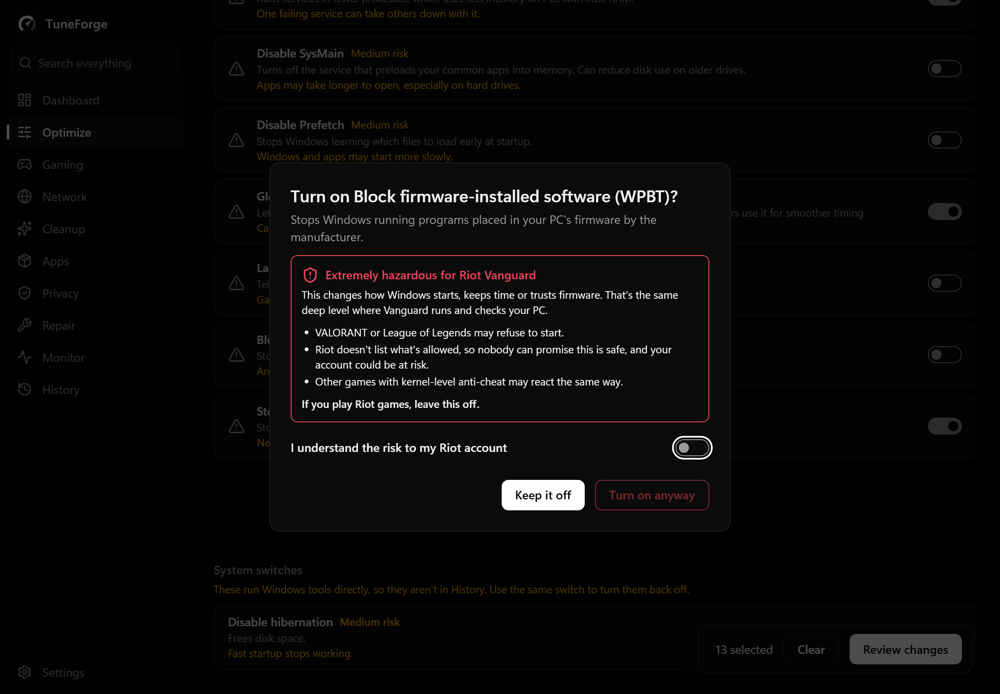

- **Review first.** Nothing changes until you've seen the list and clicked Apply.
- **Undo.** Each tweak is recorded before it's made, so you can undo it from History.
- **Restore points.** TuneForge can create a Windows restore point before applying tweaks.
- **Admin rights only when needed.** The app runs without them, and Windows asks you each time a change needs them.
- **Signed updates.** TuneForge asks before updating, and only installs updates signed by the developer.
- **Riot warnings.** Settings that touch startup, timers or firmware are marked as extremely hazardous for Riot Vanguard. They're off by default, left out of every preset, and need your confirmation.

No tool can promise what an anti-cheat will do, so if you play ranked, leave anything marked as a risk switched off.

## Make it yours

Choose from five themes, or match your Windows light or dark mode.

<table>
  <tr>
    <td>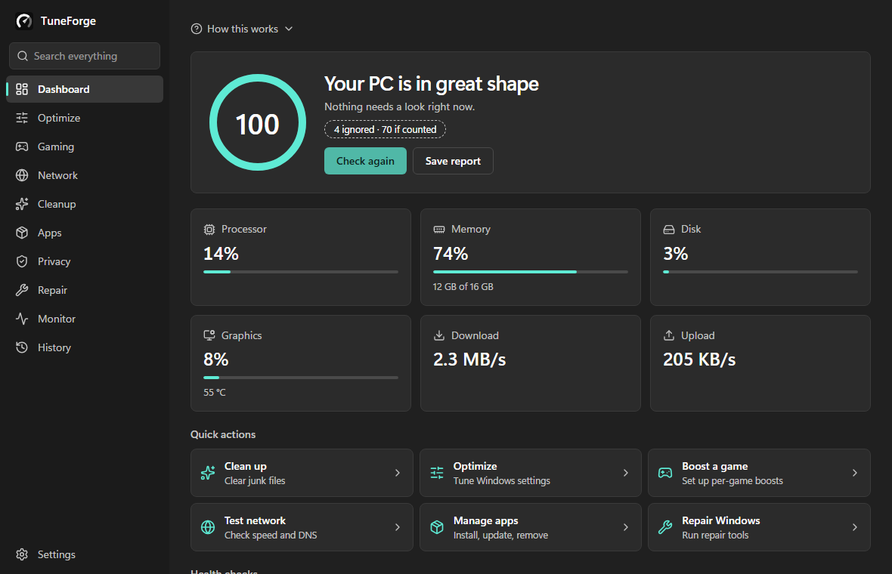
Fluent
</td>
    <td>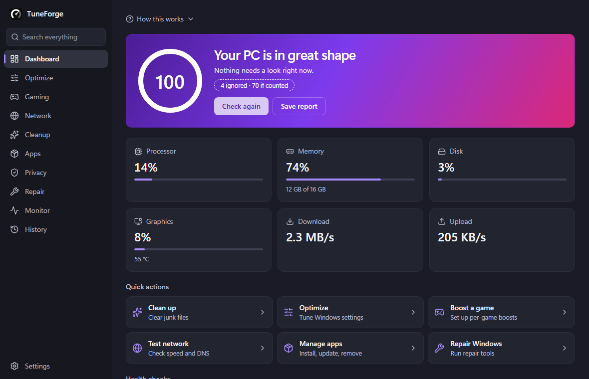
Hero
</td>
  </tr>
  <tr>
    <td>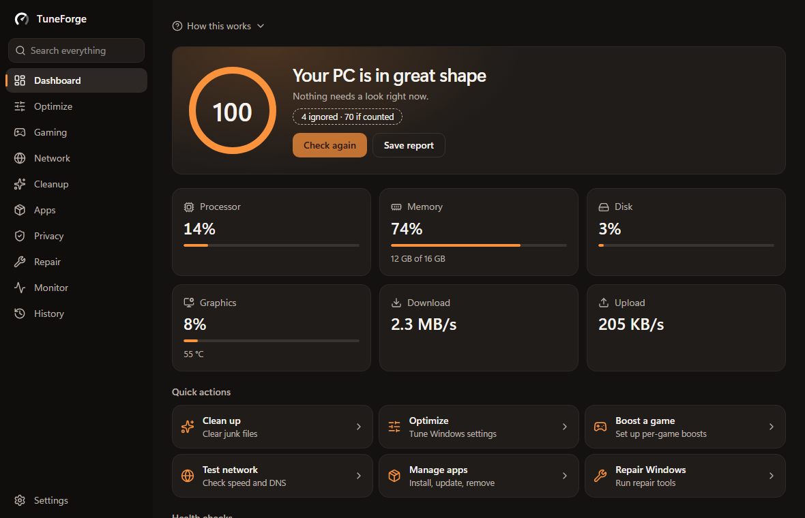
Forge
</td>
    <td>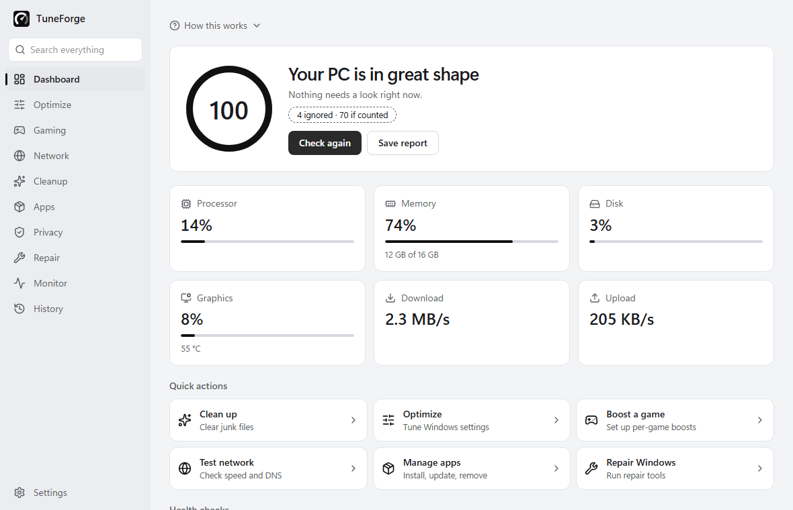
Light
</td>
  </tr>
</table>

Obsidian, the black theme shown at the top, is the default.

## Install

1. Download `TuneForge-Setup` from the [latest release](https://github.com/D3MON999/TuneForge/releases/latest).
2. Run it. Windows will show an unknown publisher warning because the app has no paid certificate, so choose **More info**, then **Run anyway**.
3. Open TuneForge. A short guide walks you through the basics.

You'll need 64-bit Windows 10 or 11 and the Microsoft Edge WebView2 Runtime, which most PCs already have.

## License

TuneForge is free and open source under the [GPL-3.0 license](LICENSE). You can use, change and share it, and anything you release from it must stay open source under the same license.

## Credits

Some tweak and app data comes from [Win11Debloat](https://github.com/Raphire/Win11Debloat) and [WinUtil](https://github.com/ChrisTitusTech/winutil), both MIT licensed. See [THIRD_PARTY_NOTICES.md](THIRD_PARTY_NOTICES.md) for details.

Screenshots use sample data.

Building it yourself? See [docs/DEVELOPMENT.md](docs/DEVELOPMENT.md).
